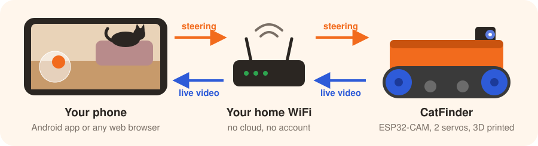
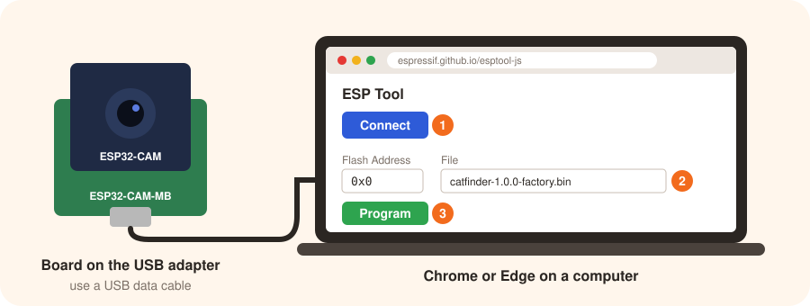
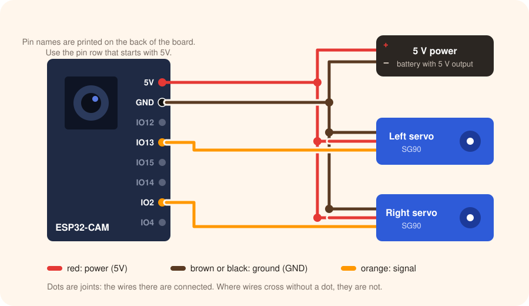
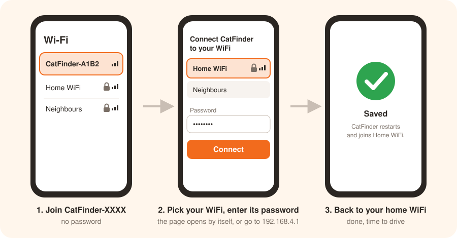
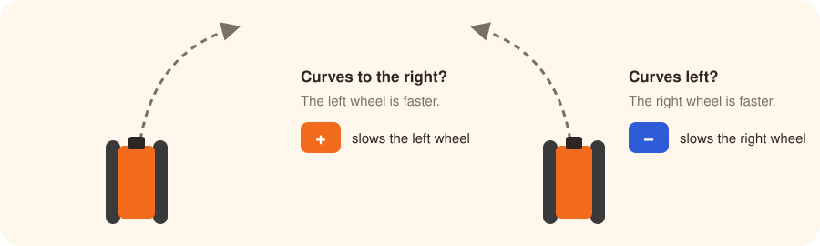
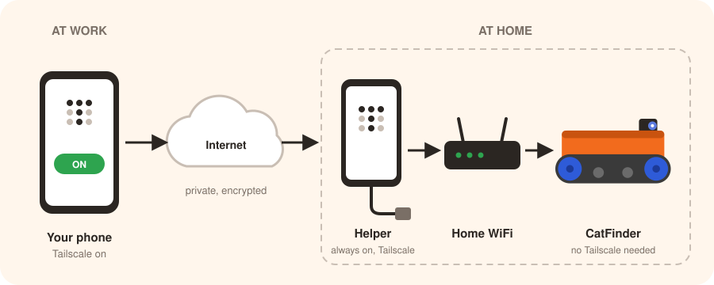

# CatFinder Supersmall

A tiny FPV tank to check on your cats while you are at work. Drive it through your home from
your phone and see what they are up to. Usually sleeping.

<!-- TODO: link the MakerWorld model page here -->
**3D printed parts:** on MakerWorld ·
**Software and Android app:** [download page](https://github.com/ThreeCatMischief/CatFinder-Supersmall/releases) ·
Free and open source

## What it does

- Live video from the tank on your phone, so you drive in first person.
- Steer with a joystick in the Android app, or in any web browser (iPhone, tablet, computer).
- Works on your home WiFi. From work or anywhere else with the free Tailscale app.
- No account, no cloud, no subscription. Everything stays in your home network.
- Saves battery by itself when nobody is driving.

You do not need to know how to program. You install the software from your browser with a
few clicks, and set up WiFi from your phone.

## What you need

| | Part | Notes |
| --- | --- | --- |
| 🖨️ | Printed parts | From the MakerWorld page. Treads in TPU. |
| 📷 | ESP32-CAM (AI Thinker) | The common ESP32-CAM board with camera. |
| 🔌 | ESP32-CAM-MB adapter | The small USB board the ESP32-CAM plugs into. Often sold together with it. Only needed to install the software. |
| ⚙️ | 2 × SG90 servo without potentiometer | They drive the treads. See [step 2](#step-2-prepare-the-servos). |
| 🛞 | 2 × 608 bearing | Standard skateboard bearing. |
| 🔋 | 5 V power source | Must deliver at least 1.5 A. Weak supplies make the board restart. |
| 🧵 | A few wires | To connect the servos and the power source. A soldering iron makes this easier. |

Also: a computer with the Chrome or Edge browser (once, for the software) and a USB **data**
cable. Some cables only charge; those do not work.

## Build it in 7 steps

1. [Print the parts](#step-1-print-the-parts)
2. [Prepare the servos](#step-2-prepare-the-servos)
3. [Install the software](#step-3-install-the-software)
4. [Wire it up](#step-4-wire-it-up)
5. [Connect it to your WiFi](#step-5-connect-it-to-your-wifi)
6. [Drive](#step-6-drive)
7. [Make it drive straight](#step-7-make-it-drive-straight)

### Step 1: Print the parts

Print the files from the MakerWorld page with the settings listed there. Print the treads in
TPU so they grip and bend around the wheels.

### Step 2: Prepare the servos

A normal SG90 servo turns only half a circle and then stops. To drive treads it has to spin
all the way round, like a small motor. That is what an SG90 **without potentiometer** does.
The potentiometer is the small knob inside that tells the servo where it is.

- Some cheap SG90s arrive without one. Those are useless as servos, but perfect here.
- If yours are complete, open the case (screws on the bottom) and remove the
  potentiometer. If the output shaft still stops after half a turn, clip off the small
  plastic tab on the top gear that blocks it.

### Step 3: Install the software

Do this **before** wiring: the USB adapter plugs onto the same pins as the wires.

1. On the [download page](https://github.com/ThreeCatMischief/CatFinder-Supersmall/releases),
   download **`catfinder-X.Y.Z-factory.bin`** (X.Y.Z is the version number).
2. Plug the ESP32-CAM onto the ESP32-CAM-MB adapter and connect it to your computer.
3. Open Espressif's installer page in Chrome or Edge:
   <https://espressif.github.io/esptool-js/>
4. Click **Connect** and pick the port that appears (often called *USB Serial* or *CH340*).
5. Enter `0x0` as **Flash Address**, choose the downloaded file and click **Program**.
   This takes about a minute.
6. When it says it is finished, press the small **RST** button on the ESP32-CAM.

> **Connect does not work?** Hold the **IO0** button on the adapter, press and release
> **RST**, let go of **IO0**, then click **Connect** again.

### Step 4: Wire it up

Take the ESP32-CAM off the adapter and connect it like this:

| Wire | Goes to |
| --- | --- |
| Power source **+** and both servos' **red** wires | **5V** |
| Power source **−** and both servos' **brown** wires | **GND** |
| Left servo, **orange** wire | **IO13** |
| Right servo, **orange** wire | **IO2** |

- Mixed up left and right? No problem, you can swap them later in the settings.
- Do not put a memory card into the ESP32-CAM. The card slot shares pins with the servos.

Then assemble the tank as shown in the photos on the MakerWorld page.

### Step 5: Connect it to your WiFi

1. Switch CatFinder on. After a few seconds it opens its own WiFi network called
   **CatFinder-XXXX**.
2. On your phone, join **CatFinder-XXXX**. It has no password.
3. A setup page opens by itself. If not, open your browser and go to <http://192.168.4.1>.
4. Pick your home WiFi, enter its password and tap **Connect**.
5. CatFinder restarts and joins your WiFi. Switch your phone back to your home WiFi.

If your phone warns that the CatFinder network has no internet, choose to stay connected.
Typo in the password? Within a minute **CatFinder-XXXX** comes back and you can try again.

### Step 6: Drive

**Android app**

1. Download **`CatFinder-X.Y.Z.apk`** from the
   [download page](https://github.com/ThreeCatMischief/CatFinder-Supersmall/releases) on your
   phone and open it.
2. Android asks whether your browser may install apps. Allow it. (The app is not in the Play
   Store.)
3. In the app, open **Settings** and tap **Find on my WiFi**.

**Web browser** (iPhone, tablet, computer)

Open <http://catfinder.local>. If that does not open, use CatFinder's address instead, for
example `http://192.168.1.50`. You find it in the app under **Find on my WiFi**, or in your
router's list of devices, where it is called **catfinder**.

Drag the circle to drive. On a computer you can also use the arrow keys or W A S D, and the
space bar to stop. The camera needs about a second to start, and the tank stops by itself if
the connection drops.

### Step 7: Make it drive straight

No two servos are exactly alike, so the tank probably curves a little at first. Open the web
page and fold out **Setup**.

**Wheels**

1. **Stop point:** press **■** for one servo. If it still creeps, change **Stop point** a few
   steps at a time until it stands still. Repeat for the other servo.
2. **Which wheel:** press **▶** for servo A. If the right tread moves, set **Which wheel** to
   *right*.
3. **Reverse direction:** drive forward. If a tread runs backwards, tick **Reverse
   direction** for it.

**Drive straight**

Pick a speed, press **Run** and watch the tank:

Repeat for each speed. Every change is saved on the tank immediately.

## Check on your cats from work

At home, CatFinder works right away. To reach it from anywhere, use
[Tailscale](https://tailscale.com), a free app that connects your own devices privately over
the internet.

You need one **helper** at home that stays switched on and connected to your WiFi. An old
Android phone on its charger works well. So do an Apple TV, a Raspberry Pi, or a computer
that never sleeps. CatFinder itself does not need Tailscale.

1. **Give CatFinder a fixed address.** In your router's settings, reserve the current address
   of the device called **catfinder** (often called *DHCP reservation* or *static lease*).
   Otherwise the address can change and the app loses it.
2. **Install Tailscale** on your phone and on the helper, and sign in with the same account on
   both.
3. **Let the helper share your home network.** Take CatFinder's address, replace the last
   number with 0 and add `/24`. For `192.168.1.50` that is `192.168.1.0/24`.
   - Android helper: in the Tailscale app, tap your account picture, then **Settings →
     Subnet routing → Add route**, enter the range and tap **OK**.
   - Apple TV, Mac, Windows, Linux, Raspberry Pi: follow
     [Tailscale's guide](https://tailscale.com/kb/1019/subnets).
4. **Approve it** in the [Tailscale admin console](https://login.tailscale.com/admin/machines):
   select the helper, then **Subnets → Edit**, tick the range and **Save**.
5. **In the CatFinder app**, enter CatFinder's address (for example `192.168.1.50`) under
   **Settings → Robot address**. Names like `catfinder.local` do not work over Tailscale.

From now on: switch Tailscale on on your phone and drive as usual. In a browser, open
`http://192.168.1.50` (with your CatFinder's address).

> Do not make CatFinder reachable from the internet through your router ("port
> forwarding"). Anyone could then watch your living room and drive the tank.

## Battery

CatFinder saves power by itself:

- The camera switches off 30 seconds after nobody watches.
- After 30 seconds without driving, WiFi and the processor slow down. CatFinder stays
  reachable; the first command after a break takes a moment longer.

It never switches itself off completely, because then it could not be woken up over WiFi.
Switch it off when you do not need it for a while.

## Something not working?

| Problem | Try this |
| --- | --- |
| It restarts again and again, or never joins the WiFi. | The power source is too weak. Use one that delivers at least 1.5 A, with short wires. |
| A tread creeps when it should stand still. | Adjust its **Stop point** ([step 7](#step-7-make-it-drive-straight)). |
| `catfinder.local` does not open. | Some phones and networks do not support these names. Use the address instead ([step 6](#step-6-drive)). |
| The app says "CatFinder not reachable". | Is CatFinder on, and your phone on the same WiFi? Away from home: is Tailscale on? |
| The video is slow or jerky. | Move closer to the router. In the app, set **Video quality** to *Auto*. |
| New router or new WiFi password. | If CatFinder cannot find its WiFi for 3 minutes, **CatFinder-XXXX** comes back: repeat [step 5](#step-5-connect-it-to-your-wifi). While still connected: **Setup → WiFi → Change WiFi network**. |
| A software update is available. | Download `catfinder-X.Y.Z.bin` (without `-factory`) and install it under **Setup → Firmware update** on the web page. |

## Share your make

Please post your make on MakerWorld, with your own cat in the frame!

## For tinkerers

Firmware, app, HTTP interface and release process: [docs/DEVELOPERS.md](docs/DEVELOPERS.md).

## License

MIT, see [LICENSE](LICENSE). Third-party notices in [NOTICE](NOTICE).
